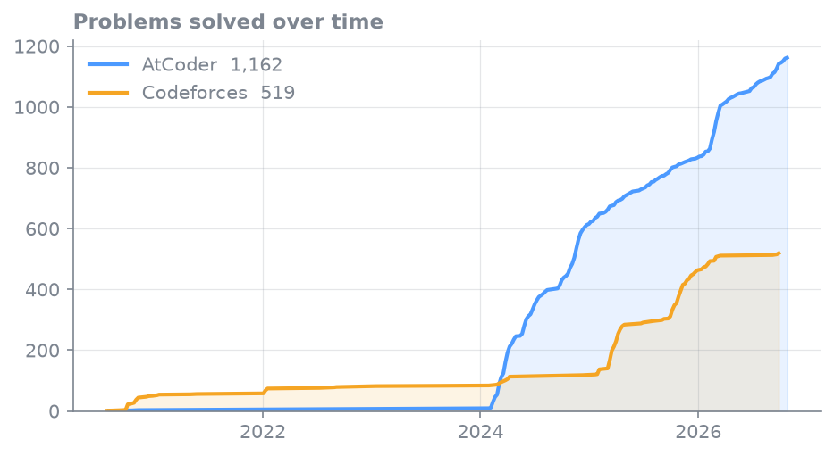
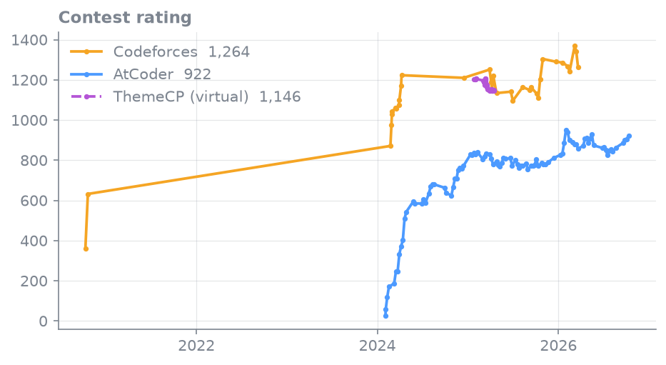
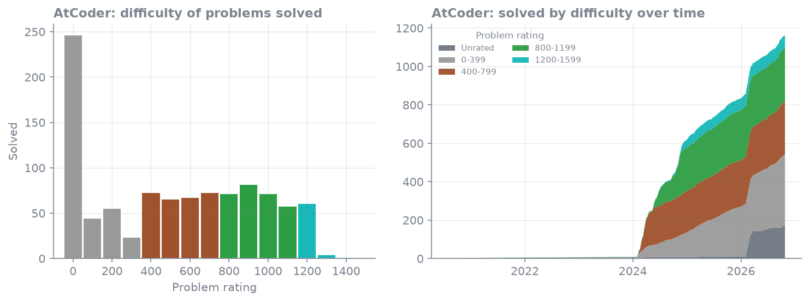
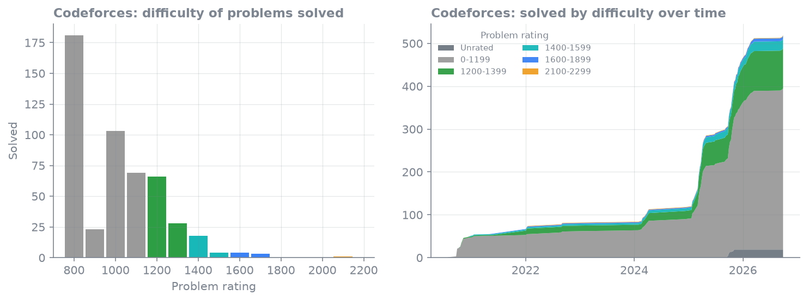
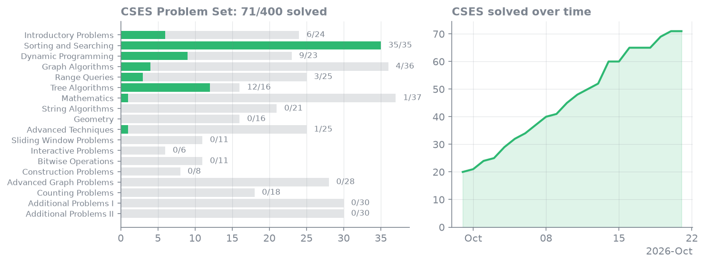
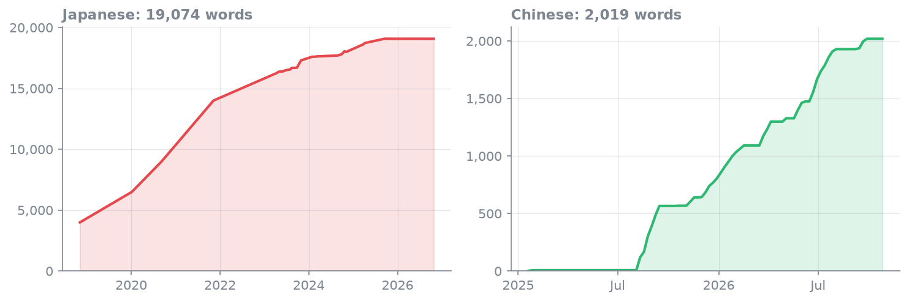

**Mexican-British software engineer, ex-NHS medical doctor and competitive programmer**

---

## 👋 About

I'm a full-stack software engineer on the legal technology team at **Barclays** in Glasgow, building contract management, regulatory review and automated drafting systems. I'm also on track for a first in **BSc Software Engineering at the University of Glasgow** (As in all courses, theoretical computer science track).

Before software I worked as a **doctor in the NHS** (St Thomas' and Guy's, London) after graduating in Medicine from the **University of Cambridge**. I now build things where those two worlds meet, and I compete in algorithmic programming in my spare time.

## 💼 Experience

**Software Engineer · Barclays** 2023 – present 
Full-stack on a legal tech team: contract management, triage and review of laws, rules and regulations, an automated first-draft contract generator and reference-data synchronisation. Angular, Spring Boot, Kafka, Kubernetes.

**Medical Doctor · National Health Service** 2021 – 2023 
Cardiology, general surgery, geriatrics, internal medicine, GP and haematology at St Thomas' and Guy's Hospitals, London.

## 🛠️ Tech

  
   
  

**Day to day:** Angular (TypeScript) · Spring Boot (Java) · Kafka · Kubernetes & Docker · GitLab CI/CD · Git 
**Also:** Python/FastAPI · C++ · Kotlin · Swift · Postgres/Supabase · Godot · Unity · AI-assisted development (Claude, Copilot, GitLab Duo)

## 🚀 Featured projects

<table>
<tr>
<td width="50%" valign="top">

### 💷 [Net Worth Dashboard](https://github.com/isym444/net-worth-dashboard)
A net-worth tracker I run myself: a **Spring Boot** service snapshots Trading212 and Crypto.com balances daily into **Postgres**, and serves an **Angular** dashboard plus **Android** (Jetpack Glance) and **macOS** (WidgetKit) widgets.

`Java` `Spring Boot` `Angular` `Kotlin` `Swift` `Docker`

</td>
<td width="50%" valign="top">

### 🩺 AgenticMD ([frontend](https://github.com/isym444/agentic_md_frontend) · [backend](https://github.com/isym444/agentic-md-backend))
An AI medical scribe built at a hackathon: record a consultation, transcribe it and generate structured clinical notes. **Angular** front end, **FastAPI** backend, **Supabase**, speech-to-text and Gemini.

`Angular` `FastAPI` `Supabase` `Gemini`

</td>
</tr>
<tr>
<td width="50%" valign="top">

### 🀄 [HSK Practice](https://github.com/isym444/hsk)
A Mandarin HSK4 practice platform with an **Angular** app, a **FastAPI + SQL** backend for review statistics and deck ordering, and a Dockerised deployment on a VPS behind Traefik.

`Angular` `FastAPI` `Postgres` `Docker`

</td>
<td width="50%" valign="top">

### 🥽 [Binary Lift VR](https://github.com/isym444/BinaryLiftVR)
A **Meta Quest** game that teaches binary lifting: race an NPC to a tree's K-th ancestor by teleporting through power-of-two portals. Core logic is unit-tested outside Unity.

`Unity` `C#` `OpenXR` `Algorithms`

</td>
</tr>
<tr>
<td width="50%" valign="top">

### 🏙️ [Stockopolis](https://github.com/isym444/2024DYHTG)
A city-builder from the **Marshall Wace** hackathon on chains of events: manage oil, wind and investment banks while stochastic market volatility moves commodity prices. Built in 24 hours in **Godot**.

`Godot` `GDScript` `Game design`

</td>
<td width="50%" valign="top">

### 🧮 [AtCoder solutions](https://github.com/isym444/atcoder_solutions)
My solutions to AtCoder problems in **C++**, plus [custom templates and tooling](https://github.com/isym444/OnlineJudgeToolsCustomTemplates) for online judges.

`C++` `Algorithms` `Data structures`

</td>
</tr>
</table>

<b>More projects</b>

- 🏎️ [Shifting Speedways](https://github.com/isym444/GUGameJam24): racing game from the Glasgow University Game Jam 2024 (Godot)
- 🔊 [Japanese TTS browser extension](https://github.com/isym444/tts-browser-extension): reads copied Japanese text aloud, with keyboard controls
- 📊 [Anki stats on the macOS menu bar](https://github.com/isym444/ankistatsonmenu): live remaining-reviews counter for chosen decks
- ⌨️ [Neovim config](https://github.com/isym444/ubuntu_nvim_config) · [Personal website](https://github.com/isym444/personal_website)

## 🏆 Highlights

- 🥇 **UKIEPC 1st place at Glasgow University** (top 15% across the UK and Ireland), qualifying for ICPC NWERC
- 🟢 **AtCoder green** (28th in the UK, top 25% worldwide)
- 🏛️ Former **president of the University of Glasgow competitive programming society**, with a university volunteering award
- 📚 **2 publications** in international medical journals (Clinical Breast Cancer, Family Practice / Oxford University Press), **36 citations**
- 🧬 **UK Biology Olympiad gold medal** and University of Cambridge violin and piano scholarships
- 🎓 **JLPT N1** passed (日本語), plus a Tsuzuki Scholarship exchange year at the Japan University of Economics, Fukuoka

## 🌍 Languages

English (native) · Español (native) · 日本語 (JLPT N1) · Français (B2) · Português (CIPLE) · 中文 (HSK 3)

<!-- STATS:START -->
## 📈 Live stats

Pulled daily from my self-hosted study-progress API. Last updated 2026-10-19.

| AtCoder | Codeforces | CSES | 日本語 |
|:---:|:---:|:---:|:---:|
| **1,155** solved rating **922** (peak 949) | **519** solved rating **1,264** (peak 1,371) | **69** / 400 17% of the set | **19,074** words JLPT N1 |

**USACO:** Silver · **ThemeCP virtual rating:** 1,146 over 37 contests

<!-- STATS:END -->

